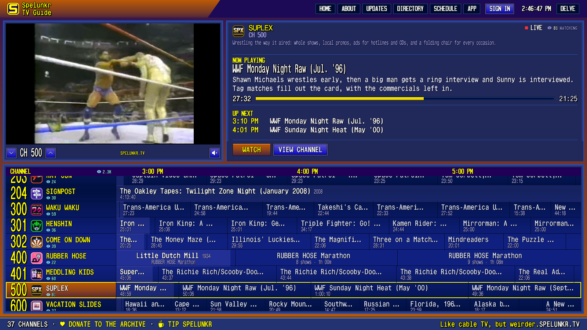
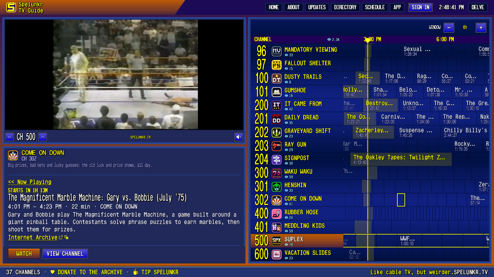
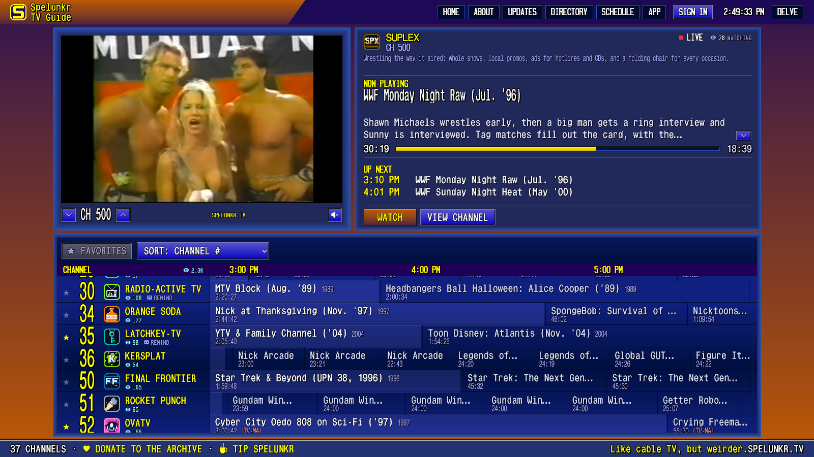
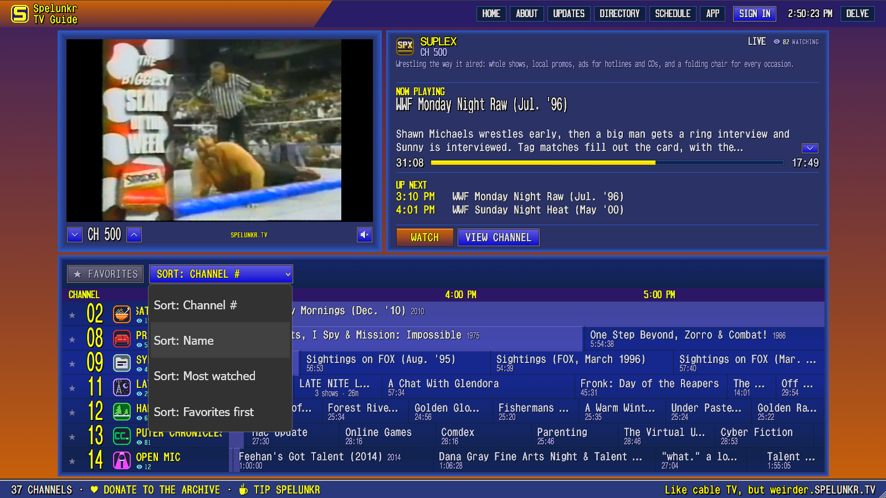
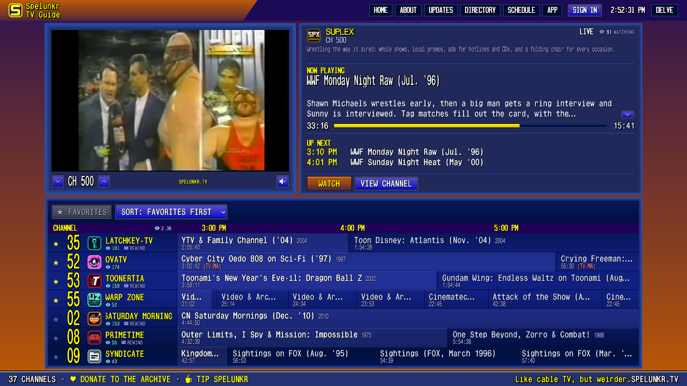
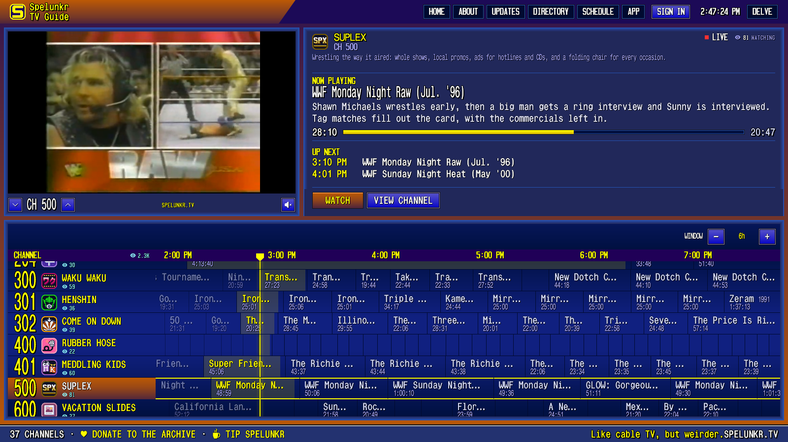

# Delve

Quality-of-life tools for [Spelunkr](https://spelunkr.tv/). Delve is a userscript that adds a few things the site doesn't have yet: more ways to lay out the guide, program info on click, favorites, sorting, a scrollable multi-day guide, and a remembered volume.

It uses the site's own fonts, colors and buttons, so it looks like part of the site.

> **Written mainly by Claude.** This project is mostly written by Claude, an AI model made by Anthropic. The author decides what it does and how it behaves.

> **Status:** Delve is a rewrite of a personal userscript, made public because certain features are requested so often in the official Spelunkr Discord. Features from the original script are being brought over one at a time.

## Install

1. Install the [Tampermonkey](https://www.tampermonkey.net/) browser extension.
2. Click **[Install Delve](https://raw.githubusercontent.com/tau-samsara/delve/main/delve.user.js)**. Tampermonkey opens an install page; click **Install**.
3. Open [spelunkr.tv](https://spelunkr.tv/). A **DELVE** button now appears in the top bar.
4. Click **DELVE** and switch on the features you want. They are all off until you do.

Installing from that link also turns on automatic updates: Tampermonkey checks for new versions on its own (daily by default). If you pasted the script in by hand instead, it won't update itself.

The script only runs on `spelunkr.tv`. It makes one outside request, to `data.spelunkr.tv`, the site's own data host, to look up program descriptions.

## Opening the menu

Click **DELVE** in the top bar (at the far right, after the clock). It's on every page of the site; on the landing page it sits with the Directory, About and Updates links. A drawer slides in from the right. Click anywhere outside it, or the **✕**, to close it. The drawer also closes when you go to another page.

## Features

### View type

Changes how the guide page is arranged. Pick one in the drawer:

| View | What it does |
|---|---|
| **Default** | The site's normal layout. |
| **Wide** | Uses the full window width. The video and info sit above the guide (at most 44% of the window height), and the guide fills the rest. |
| **Split** | Video and info on one half of the screen, the guide on the other half. Needs a window at least 1400 px wide; on narrower windows it falls back to Wide. |
| **Adaptive** | Picks for you based on window width: Default when narrow, Wide in the middle, Split on very wide screens. |

**Video side** (Left / Right) chooses which half the video takes in Split, and in Default and Wide it puts the video column on that side too.

Wide and Split also apply to watch mode and channel mode, with smooth transitions between modes. On phone-width windows (768 px and under) the site's own single-column layout is used and Delve steps aside.

### Program info

Click a program in the guide to see its details in the info column under the video, without changing what's playing:

- title, year, and season/episode tags
- start time, duration and channel
- the full description
- links to **IMDb** and the **Internet Archive**, each with a small copy-link button
- for marathons, the list of shows in the block

Click the same program a second time to tune the preview to it. **<< Now Playing** takes you back. The IMDb and Archive links also appear under the currently playing program in the guide, watch and channel views.

### Favorites

Every channel in the guide has a star at the left. Click it to mark or unmark a channel (it won't tune the channel). Use the **★ Favorites** button in the guide toolbar to show only your favorites.

### Sort

The **Sort** drop-down in the guide toolbar orders the channels by:

- Channel #
- Name
- Most watched (by viewer count)
- Favorites first

### Extended guide

Turns the guide into a long, sideways-scrolling timeline that shows programs that already aired as well as ones coming up. It looks like the site's guide, just longer.

- Opens with the left edge about 30 minutes before now, with a pulsing **Now** line.
- Starts with 12 hours on each side of now. Scroll toward either end and it loads another 24 hours, up to 2 days each way.
- Programs that already ended are dimmed. The program playing now is highlighted in yellow.
- At midnight the time row shows the day and date (for example `SUN 11/22`).
- **Window** (− / +) on the toolbar sets how much time fits on screen: 30 minutes, 1, 3, 6 or 12 hours.
- **Now** jumps back to the present.
- Click and drag to scroll the guide, or use the mouse wheel or trackpad.

### Volume and mute

- Your volume is remembered between visits.
- Whether you left the video muted is remembered too. If you left it unmuted, the first click or key press on the page unmutes it (browsers don't allow sound before that).
- A mute button is added to the guide's controls when the site hasn't drawn its own.

### Turning features on

The drawer has an On/Off switch for each of these. They are all **off by default**, so turn on the ones you want:

- Program information
- Favorites
- Sort
- Extended guide (the wider timeline, Window zoom, Now button and Now line)

## Your settings

Everything is saved by Tampermonkey, in your browser, and kept between visits: view type, video side, favorites, the favorites-only toggle, sort, window size, volume, mute, and the feature switches. Nothing is sent anywhere.

## Troubleshooting

- **The DELVE button isn't there:** check that Tampermonkey is enabled for `spelunkr.tv` and that only one Delve script is installed.
- **Split looks like Wide:** your window is under 1400 px wide.
- **Descriptions or links are missing:** not every program has an IMDb or Archive entry, and descriptions come from `data.spelunkr.tv`. Make sure Tampermonkey allows that connection.
- **Something looks wrong after a site update:** Delve depends on the site's page structure, so site changes can break it. Reload first, then report the problem.

## Planned

Ideas under consideration:

- Volume boost and normalization
- CRT display options (scanlines, bezels, stretch, crop, zoom)
- More themes
- Mono-to-stereo and force-mono audio
- Hide comments separately from reactions
- A local "tape stack" for bookmarking programs, with personal notes
- Hotkeys
- Picture tweaks (contrast, brightness, saturation, dim, lights-out)
- Channel flipper, "Spelunk my favorites" and auto-surf
- Channel watermark toggle or opacity
- A test pattern screen when a stream fails
- Start times, past blocks and "late night" labels in the guide
- Theater mode
- 24-hour clock toggle
- Tooltips for tags like [rewind]
- An always-visible volume slider
- A close button or minimal chrome on desktop
- An ambient screensaver mode

## License

[MIT](LICENSE). Keep the copyright notice if you copy or modify the script.
