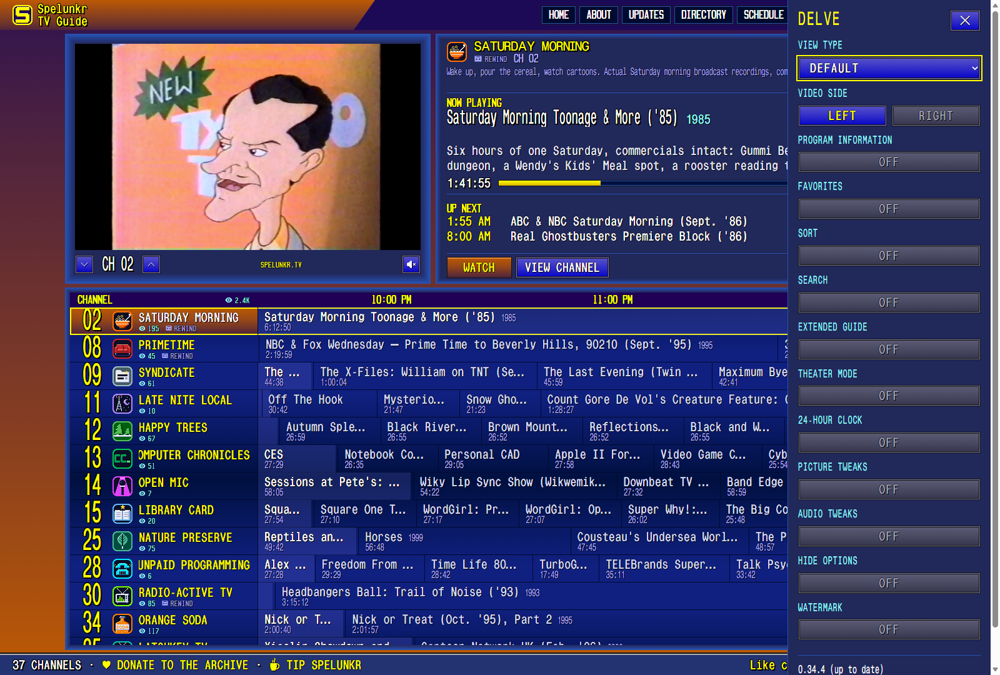
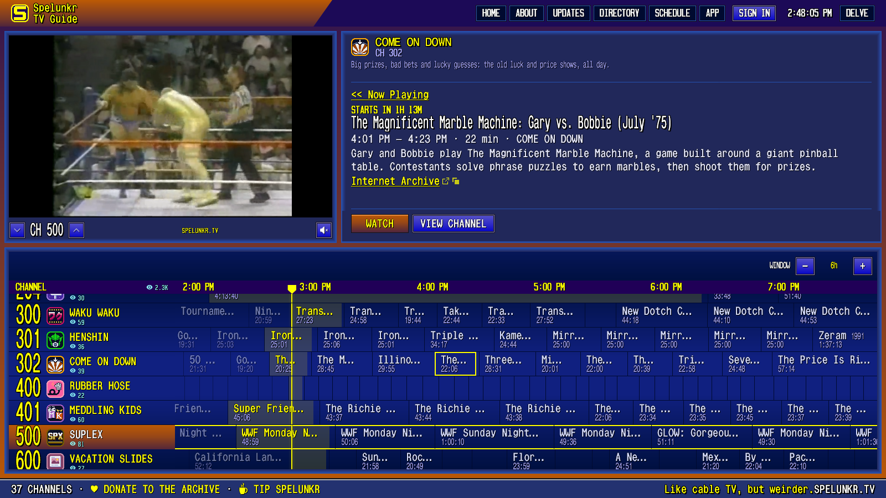
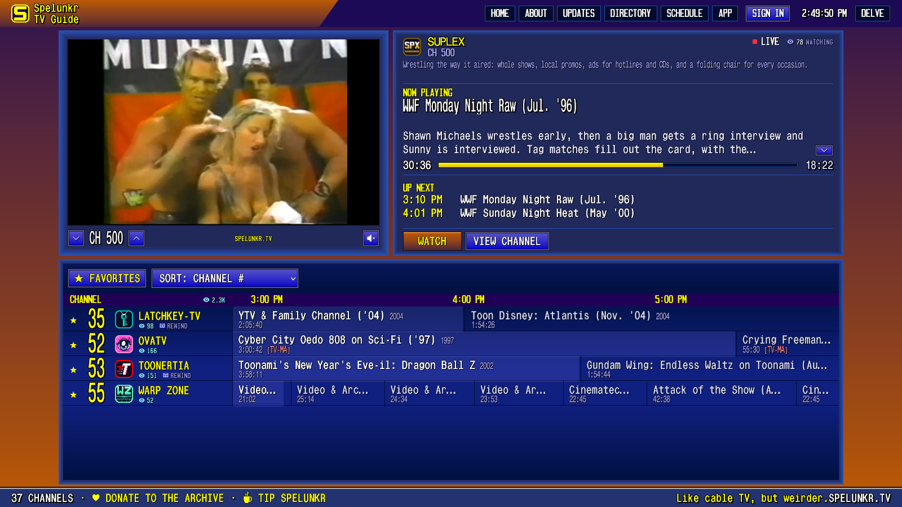
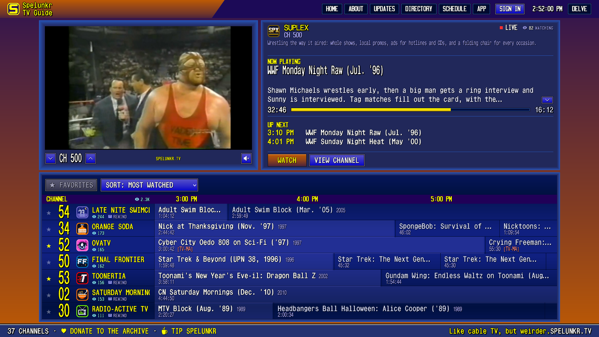
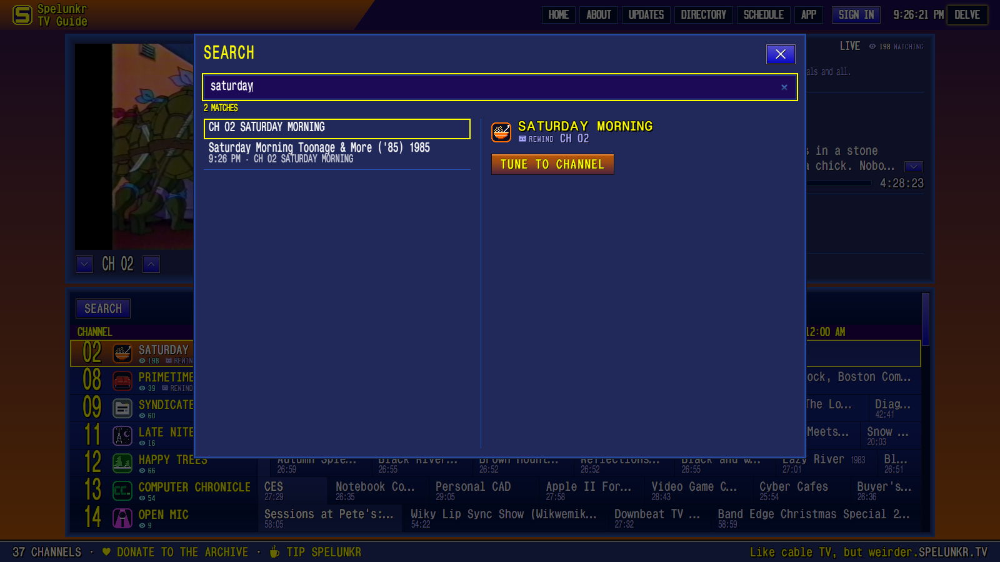
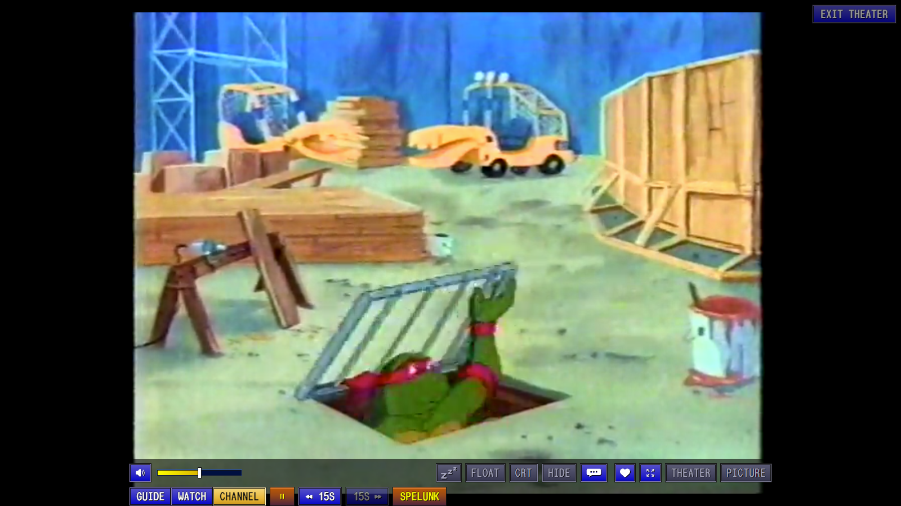
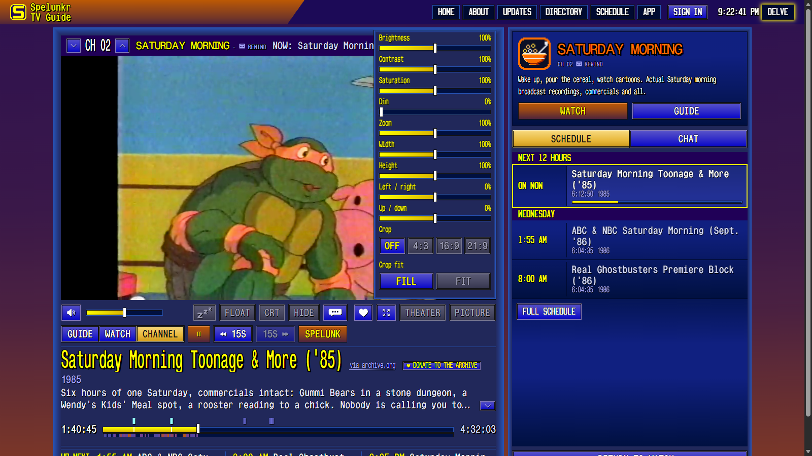
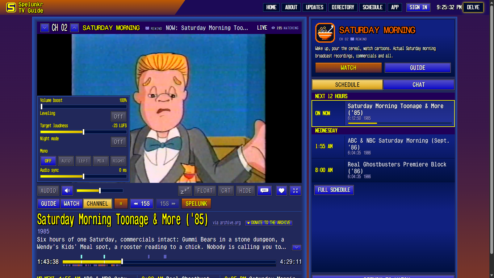
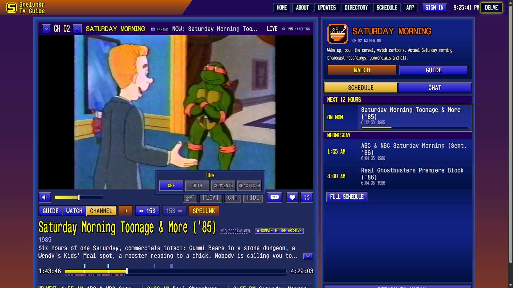
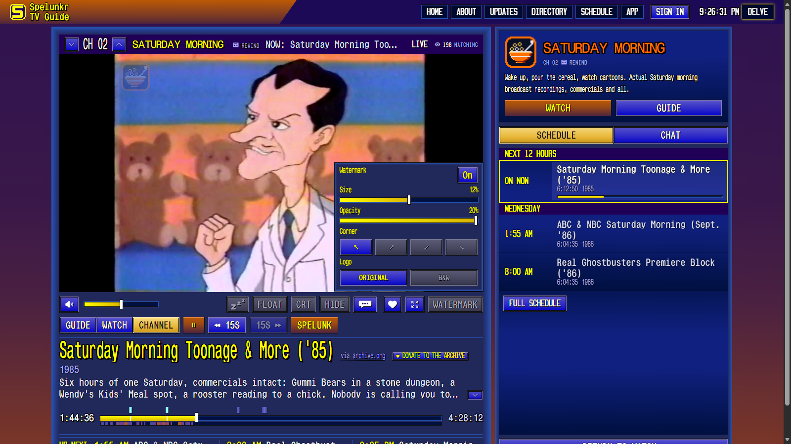

# Delve

Quality-of-life tools for [Spelunkr](https://spelunkr.tv/). Delve is a userscript that adds things the site doesn't have yet: more ways to lay out the guide, program info on click, favorites, sorting, a scrollable multi-day guide, picture and audio tweaks, and more. It uses the site's own fonts, colors and buttons, so it looks like part of the site.

> **Written mainly by Claude.** This project is mostly written by Claude, an AI model made by Anthropic. The author decides what it does and how it behaves.

> **Status:** Delve is a rewrite of a personal userscript, made public because certain features are requested so often in the official Spelunkr Discord. Features from the original script are being brought over one at a time.

## Install

1. Install the [Tampermonkey](https://www.tampermonkey.net/) browser extension.
2. Click **[Install Delve](https://raw.githubusercontent.com/tau-samsara/delve/main/delve.user.js)**. Tampermonkey opens an install page; click **Install**.
3. Open [spelunkr.tv](https://spelunkr.tv/). A **DELVE** button now appears in the top bar.
4. Click **DELVE** and switch on the features you want. They are all off until you do.

Installing from that link also turns on automatic updates: Tampermonkey checks for new versions on its own (daily by default). If you pasted the script in by hand instead, it won't update itself.

### What it connects to

The script only runs on `spelunkr.tv`. Outside requests:

| Host | Why | When |
|---|---|---|
| `data.spelunkr.tv` | Program descriptions (the site's own data host) | When you look up a program |
| `raw.githubusercontent.com` | The published version number, and the changelog | About once an hour; the changelog when you open **What's new** |
| `archive.org` | The video streams | Only with Audio tweaks on |
| `cdn.jsdelivr.net` | The MP4Box library (pinned to one version and checked against a hash by Tampermonkey) | Only with Audio tweaks on |

## The DELVE menu

Click **DELVE** in the top bar (at the far right, after the clock). It's on every page of the site; on the landing page it sits with the Directory, About and Updates links. A drawer slides in from the right. Click anywhere outside it, or the **✕**, to close it. The drawer also closes when you go to another page.

The drawer has three groups: **Layout**, **Guide** and **Player**. Click a group's arrow to fold or unfold it; the drawer remembers which are folded. The title and the footer stay in place while the list scrolls. **Reset all settings** in the footer puts every setting back to its default, including your favorites and remembered volume; click it twice to confirm.

Every feature has an On/Off switch and is **off by default**.

## Features

| Group | Feature |
|---|---|
| Layout | [View type](#view-type) |
| Guide | [Program information](#program-information) · [Favorites](#favorites) · [Hide channels](#hide-channels) · [Sort](#sort) · [Search](#search) · [Extended guide](#extended-guide) · [24-hour clock](#24-hour-clock) · [Tag tooltips](#tag-tooltips) · [Watcher count](#watcher-count) · [Tape stack](#tape-stack) |
| Player | [Theater mode](#theater-mode) · [Picture tweaks](#picture-tweaks) · [Audio tweaks](#audio-tweaks) · [Hide options](#hide-options) · [Watermark](#watermark) · [Volume slider](#volume-slider) · [Auto spelunk](#auto-spelunk) |

Two things work without a switch: [volume and mute](#volume-and-mute) and [updates](#updates).

## Layout

### View type

Changes how the guide page is arranged. Pick one in the drawer:

| View | What it does |
|---|---|
| **Default** | The site's normal layout. |
| **Wide** | Uses the full window width. The video and info sit above the guide (at most 44% of the window height), and the guide fills the rest. |
| **Split** | Video and info on one half of the screen, the guide on the other half. Needs a window at least 1400 px wide; on narrower windows it falls back to Wide. |
| **Adaptive** | Picks for you based on window width: Default when narrow, Wide in the middle, Split on very wide screens. |

**Video side** (Left / Right) chooses which half the video takes in Split, and in Default and Wide it puts the video column on that side too.

Wide and Split also apply to watch mode and channel mode, with smooth transitions between modes. In watch mode, Wide puts the guide below the video; Split puts the video on one half and the guide on the other, with no page scrolling. On phone-width windows (768 px and under) the site's own single-column layout is used and Delve steps aside.

## Guide

### Program information

Click a program in the guide to see its details in the info column under the video, without changing what's playing:

- title, year, and season/episode tags
- start time, duration and channel
- the full description
- links to **IMDb** and the **Internet Archive**, each with a small copy-link button
- for marathons, the list of shows in the block

Click the same program a second time to tune the preview to it. **<< Now Playing** takes you back. In watch mode with the Split layout, the same card appears in a panel above the guide, closed with an X button in its top right corner instead of the << Now Playing link; in other layouts a click in watch mode tunes the channel. The IMDb and Archive links also appear under the currently playing program in the guide, watch and channel views.

### Favorites

Every channel in the guide has a star at the left. Click it to mark or unmark a channel (it won't tune the channel). On a channel's own page a **FAVORITE** button (gold while the channel is starred) sits above the WATCH and GUIDE buttons. Use the **★ Favorites** button in the guide toolbar to show only your favorites.

### Hide channels

Every channel gets a small **✕** beside its star. Click it to hide that channel from the guide (it won't tune the channel). The **⊘ Hidden** button in the guide toolbar shows the hidden channels again, dimmed, with a **↺** to bring one back.

Hidden channels are skipped:

- They are not searched.
- Flipping with Channel Up / Down (the buttons or W and S) passes over them.
- SPELUNK (the button or R) and the Auto spelunk timer never stay on one.
- While shown dimmed, a click on them does nothing except ↺.

If you reach a hidden channel some other way (typing its address, for example), the video's stream is removed, so nothing plays. On a channel's own page a **HIDE CHANNEL** button above WATCH and GUIDE hides it (the stream is removed at once); the same button, now **UNHIDE CHANNEL**, brings it back.

### Sort

The **Sort** drop-down in the guide toolbar orders the channels by:

- Channel #
- Name
- Most watched (by viewer count)
- Favorites first

When the order changes while you watch (for example a channel's viewer count rises), a channel that moves up flashes briefly in yellow.

### Search

The **Search** button in the guide toolbar opens a popup with a text box. Type part of a channel name or number, or a show title. Results list the matching channels and the programs that are loaded: what the guide shows, or the whole timeline when the Extended guide is on. Channels hidden by the Favorites button are not searched.

The results are on the left. Click one and its information appears on the right. At the top is the channel (icon, name, number and description) with a **Tune to channel** button, which closes the popup and tunes that channel. Under it, for a program: title, year, season and episode, time, length, description, and IMDb and Internet Archive links. A channel result shows only the channel part. On a phone the information sits below the results. Close the popup with ✕ or by clicking outside it.

### Extended guide

Turns the guide into a long, sideways-scrolling timeline that shows programs that already aired as well as ones coming up. It looks like the site's guide, just longer.

- Opens with the left edge about 30 minutes before now, with a pulsing **Now** line.
- Starts with 12 hours on each side of now. Scroll toward either end and it loads another 24 hours, up to 2 days each way.
- Programs that already ended are dimmed. The program playing now is highlighted in yellow.
- At midnight the time row shows the day and date (for example `SUN 11/22`).
- A label on the toolbar shows how much is loaded, for example `Mon 9:00 PM – Wed 9:00 PM`, and grows as more loads.
- **Window** (− / +) on the toolbar sets how much time fits on screen: 30 minutes, 1, 3, 6 or 12 hours.
- **Now** jumps back to the present.
- Click and drag to scroll the guide, or use the mouse wheel or trackpad.

### 24-hour clock

The header clock, guide time labels, Up Next times, marathon tooltips and Delve's program card show 19:00 instead of 7:00 PM. Switching it off restores the original text.

### Tag tooltips

Hovering the REWIND tag in the guide explains it: original broadcasts, with commercials, variety programming and whole blocks.

### Watcher count

The total number of people watching, copied from the site's own figure: a badge to the right of the header clock and a Watching card on the home page. The home page does not load the figure itself, so its card appears once the guide or a channel has been open since the page loaded. Off-screen on a phone, where the header has no room.

### Tape stack

A personal playlist of programs. With this on, a **☆ Save tape** button appears at the right end of the guide's WATCH / VIEW CHANNEL row, for the program whose card is open or, when no card is open, for the one the site's Now playing block shows (this needs Program information on, which finds the program); saved programs show **★ Saved**, and pressing it again removes the tape. (In Split's watch view, where the guide sits below the player, the button is at the top of the card instead.) Marathon blocks have no single video and can't be saved.

The guide's info column gets two tabs, **INFO** and **TAPES (n)**. TAPES lists your tapes with their year and length. Click a tape to open it:

- a **note** (saved as you type)
- a flag: **Normal**, **Broken** or **Quiet**, shown as a tag on the tape
- **Play from here**: reloads the page onto the TAPES channel with this tape first (not shown for Broken tapes)
- **Remove**

The tapes also play as a channel. When you have saved tapes, a **TAPES** channel is added to the guide (the first free dial number from 99) and plays them one after another, looping, starting when the page loads, or at the tape you chose with **Play from here**. You tune it, watch it and rewind it like any other channel. Tapes marked **Broken** are left out of it. The channel is built when the page loads, so changes to your tapes show up in it after a reload.

Tapes are stored by Delve in your browser, apart from the settings, so **Reset all settings** keeps them and switching the feature off keeps them too. Nothing is sent anywhere; the TAPES channel exists only in your browser, and the site's player plays the same archive.org video files it plays for any channel.

## Player

### Theater mode

A **THEATER** button in the player's key row, in watch and channel mode. The video fills the whole window on black, with no header, guide or footer; the player's key row sits over the bottom of the picture, so PICTURE and the other buttons still work.

**EXIT THEATER** in the top right corner goes back, and so does leaving the watch view. Changing channel keeps theater mode on. After 3 seconds without mouse movement the exit button fades, the key row slides down out of view and the mouse pointer hides; moving the mouse brings them back. Theater mode is not remembered between visits.

### Picture tweaks

A **PICTURE** button in the player's key row, in watch and channel mode, opens a panel. The video changes as you drag, in every view. Click elsewhere to close. The settings are remembered.

| Control | Range |
|---|---|
| **Brightness**, **Contrast** | 50% to 150% |
| **Saturation** | 0% to 200% |
| **Dim** | 0% to 90% toward black |
| **Zoom** | 50% to 150% |
| **Width**, **Height** | 50% to 150% each, stretching one direction only |
| **Left / right**, **Up / down** | Up to 25% either way, like a TV's overscan: the picture moves, the far edge is cut off and black shows on the other side |
| **Crop** | Off, 4:3, 16:9 or 21:9: the largest box of that shape that fits the player, centered |
| **Crop fit** | **Fill** scales the picture to the box, cutting what overflows; **Fit** scales it to fit inside, cutting nothing |

### Audio tweaks

An **AUDIO** button appears just left of the mute button in watch and channel mode. It opens a panel, from top to bottom:

| Control | What it does |
|---|---|
| **Volume boost** | A slider from 100% to 300%, for channels that play too quietly. |
| **Leveling** and **Target loudness** | Evens out the volume: quiet channels are lifted and loud ones trimmed toward the target (-30 to -16 LUFS, -23 by default), with a limiter to prevent clipping. The sound fades in when you change channel. |
| **Night mode** | Compresses the sound: loud moments are pulled down toward the quiet ones, so you can keep the volume low without losing the dialogue. |
| **Hiss reduction** | Turns the highs above 6 kHz down by 6 dB, which softens tape and stream hiss. It also makes everything sound a little duller. |
| **Mono** | A row of five choices: **Off**, **Auto**, **Left**, **Mix**, **Right**. Left or Right plays that channel in both ears and Mix plays both mixed (at half level), for files with sound in one ear only. |
| **Audio sync** | -1000 to +1000 ms. Minus plays the sound earlier, plus later, for sources whose sound is out of step with the picture. The buffer reloads once you let go of the slider (or pause for a moment), so the video stalls for a second per adjustment, not per step. |

**Auto** (in the Mono row) listens for about ten seconds of sound and then picks for you:

- a dead side (30 dB or more quieter): plays the other side in both ears;
- sides that differ by 1 dB or more: Mix;
- evenly balanced sound: nothing changes and Auto switches itself off.

It decides once. Select Auto again to repeat it, for example on another channel.

All of these are remembered, and they apply to every channel: Delve does not reset Audio sync or Mono when you change channel, so set them back to 0 ms and Off if a channel doesn't need them. Leveling starts fresh on each channel.

**How it works.** The site's video comes straight from archive.org, and a browser won't let a script process the sound of a video from another website. So, while Audio tweaks is on, Delve plays the stream itself: it fetches the video from archive.org in pieces, with audio and video fetched separately, and feeds it to the player. Seeking works as usual. Tampermonkey may ask you once to allow connections to `archive.org`; allow it.

- Channels whose files store the index at the end (very large files) can take a little longer to start.
- A failed request is retried twice. If a stream still can't be played this way, the site plays it as before, and the audio tweaks do nothing for that stream.
- Once a stream has been swapped, switching Audio tweaks off keeps the swap until you reload the page, with the boost back at 100%.
- If a stream can't be swapped *after* another channel has already been, the browser plays it silent until you reload the page. When the cause is the connection (the download kept failing), Delve first tries the swap again up to three times, about three seconds apart, with the picture blank meanwhile, and only then gives up.

### Hide options

The site's HIDE button, in the player's key row, opens a small popup with **Off**, **Both**, **Comments** and **Reactions**:

- **Comments** hides the comment markers on the scrub bar and the comment pop-ups on the video.
- **Reactions** hides the reaction strip on the scrub bar and the hearts that float up over the video.
- **Both** hides all of them.

The choice is remembered. Delve keeps the site's own HIDE state off, so the button no longer toggles anything by itself. On a phone, HIDE is in the site's **MORE** row.

### Watermark

A **WATERMARK** button in the player's key row opens a popup that puts the channel's logo over a corner of the visible picture, not over the black bars. With Picture tweaks on, the corner is that of the picture where it meets the Crop box, after Zoom and alignment.

- **On/Off** (the watermark is Off until you turn it on in the popup)
- **Size**: 4% to 20% of the visible picture's height
- **Opacity**: 1% to 20%, in 1% steps
- **Corner**
- **Logo**: Original, or **B&W** (the logo without its background, drawn in white and grays)

The settings are remembered.

### Volume slider

In the guide's compact player the site shows no volume slider. With this on, hovering the mute button opens a small volume slider above it, and it closes when the pointer leaves. Moving the slider changes the volume only; it does not mute or unmute.

### Auto spelunk

An **AUTO** button next to the site's SPELUNK button opens a popup: **Off**, **15 s**, **30 s**, **1 min** or **5 min**. Pick an interval and Delve presses SPELUNK for you each time the countdown shown on the AUTO button reaches zero, so you land on a new random channel. Pressing SPELUNK yourself restarts the countdown. The chosen interval is remembered, so auto spelunk carries on after you reload.

The popup's **Spelunk among** row switches between **All channels** and **★ Favorites**. With Favorites, both SPELUNK and the timer jump to a random starred channel other than the one you are on. The row only shows while the Favorites switch is on; with Favorites off, SPELUNK and the timer never pick from your stars. If you have no other starred channel, SPELUNK does its usual random jump.

## Always on

### Volume and mute

- Your volume is remembered between visits.
- Whether you left the video muted is remembered too. If you left it unmuted, the first click or key press on the page unmutes it (browsers don't allow sound before that).
- A mute button is added to the guide's controls when the site hasn't drawn its own.

### Updates

About once an hour Delve reads the version number of the published script on GitHub. When a newer one exists, the DELVE button pulses with a gold glow. The bottom of the menu shows the installed version and a button. When an update is available it reads **Update Available** (gold) and opens the script so Tampermonkey can install it; otherwise it reads **Check for Updates** and checks GitHub right away.

**What's new** (below the update button) opens a popup with the changelog: what changed in each version, newest first. It is read from `CHANGELOG.md` on GitHub when you open it, so it also lists versions you haven't installed yet. The same file is in the repository.

## Your settings

Everything is saved by Tampermonkey, in your browser, and kept between visits: view type, video side, favorites, the favorites-only toggle, hidden channels, sort, window size, volume, mute, the audio settings (boost, leveling and its target, night mode, hiss reduction, Mono and its choice, sync), the picture settings, the Hide choice, the watermark settings, the auto spelunk interval and its All channels / Favorites choice, and the feature switches. Your saved tapes are stored separately. None of it is sent anywhere.

## Troubleshooting

- **The DELVE button isn't there:** check that Tampermonkey is enabled for `spelunkr.tv` and that only one Delve script is installed.
- **Split looks like Wide:** your window is under 1400 px wide.
- **Descriptions or links are missing:** not every program has an IMDb or Archive entry, and descriptions come from `data.spelunkr.tv`. Make sure Tampermonkey allows that connection.
- **Audio tweaks: a channel has no sound or the AUDIO button does nothing:** that stream couldn't be played through Delve (see the Delve messages in the browser console, which start with `[delve]`). Reload the page; if the channel keeps failing, switch Audio tweaks off for it.
- **Audio tweaks: Tampermonkey asks about archive.org:** that is the stream fetch described under [Audio tweaks](#audio-tweaks). Allow it, or the feature can't work.
- **Something looks wrong after a site update:** Delve depends on the site's page structure, so site changes can break it. Reload first, then report the problem.

## Planned

Ideas under consideration:

- A CRT look (scanlines, grain, glow, bezels)
- More themes
- Hotkeys
- A test pattern screen when a stream fails
- A cleaner or more customizable guide
- Skipping TV-MA programs when flipping channels, unless you opt in
- An ambient screensaver mode

## License

[MIT](LICENSE). Keep the copyright notice if you copy or modify the script.
